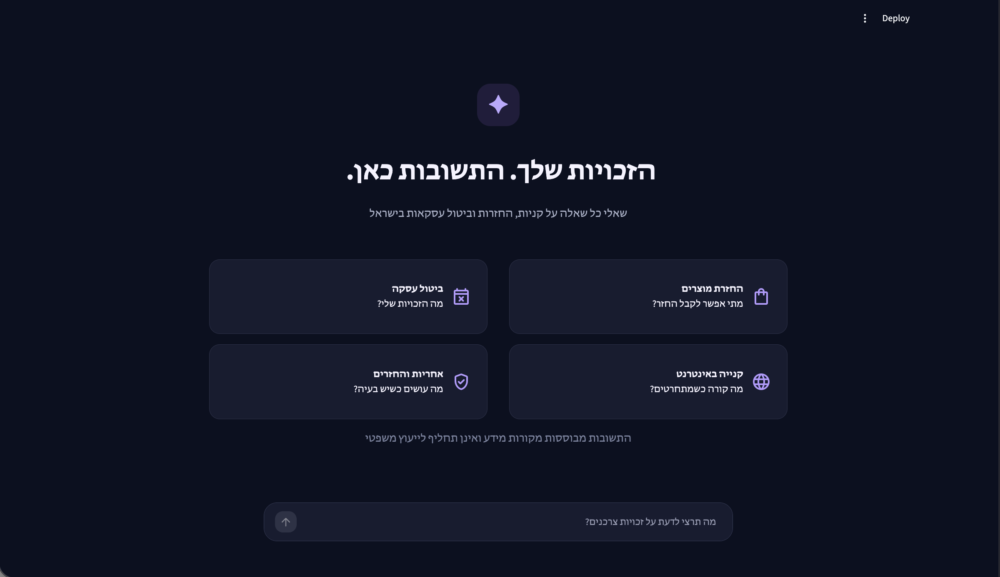
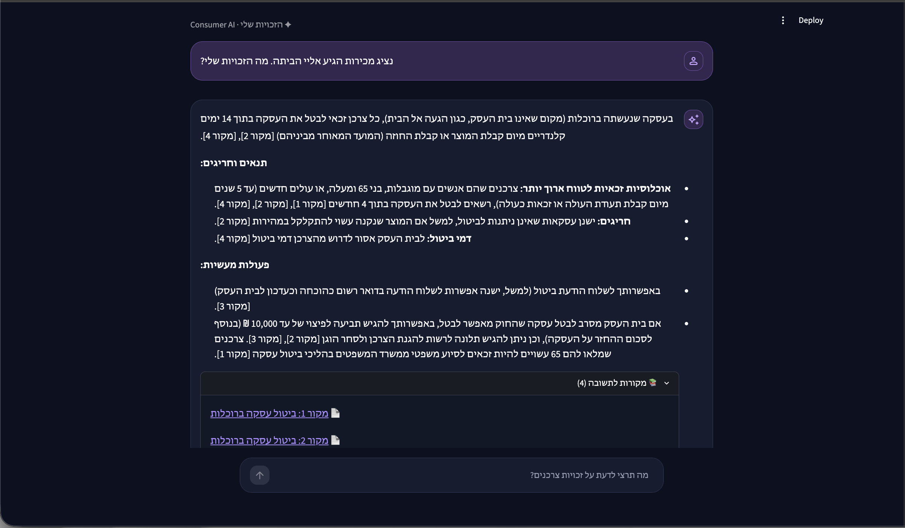

# Consumer-RAG

### A Hebrew Consumer Rights Assistant Powered by Retrieval-Augmented Generation

Consumer-RAG is an end-to-end Retrieval-Augmented Generation (RAG) project designed to answer Hebrew-language consumer-rights questions using information retrieved from [Kol Zchut](https://www.kolzchut.org.il/).

The system combines multilingual semantic search, LLM-assisted query understanding, reranking, rank fusion, and grounded answer generation with source citations.

The project was developed as a practical exploration of RAG architecture, retrieval quality, evaluation, and reliable LLM-based question answering.

## Key Features

- Hebrew-language consumer-rights question answering
- Automated document collection with robots.txt compliance checks
- Text cleaning, document chunking, and multilingual embeddings
- ChromaDB vector storage and semantic retrieval
- LLM-assisted legal topic classification and query expansion
- Cross-encoder reranking and Reciprocal Rank Fusion (RRF)
- Category-aware retrieval boosting
- Gemini-based answer generation with source citations
- Abstention behavior when the available sources do not sufficiently support an answer
- FastAPI backend and Streamlit chat interface
- Automated retrieval evaluation and answer-quality testing

## Application Screenshots

### Home Screen

A Hebrew-first interface with suggested questions about consumer rights in Israel.



### AI-Generated Answer with Sources

A grounded Hebrew answer with references and direct links to the supporting sources.



## Architecture

```text
Kol Zchut Sources
        |
        v
Document Collection & Cleaning
        |
        v
Document Chunking
        |
        v
Multilingual E5 Embeddings
        |
        v
ChromaDB Vector Index

User Question
        |
        v
LLM Topic Classification & Query Expansion
        |
        v
Semantic Retrieval
        |
        v
Cross-Encoder Reranking
        |
        v
Reciprocal Rank Fusion + Category Boosting
        |
        v
Top-K Context Selection
        |
        v
Gemini Answer Generation
        |
        v
Grounded Answer + Source Citations
```

## Technology Stack

| Component | Technology |
|---|---|
| Programming language | Python |
| API | FastAPI |
| User interface | Streamlit |
| Vector database | ChromaDB |
| Embeddings | multilingual-e5-small |
| Reranking | BGE Reranker v2 M3 |
| LLM | Google Gemini |
| Testing | pytest |
| Evaluation | Retrieval metrics, citation validation, LLM-assisted evaluation |

## Evaluation

The retrieval pipeline was evaluated on a 50-question Hebrew consumer-rights holdout dataset.

Of these questions, 42 had labeled relevant chunks and were included in the retrieval metric calculations.

| Metric | Result |
|---|---:|
| Hit@1 | 54.76% |
| Hit@3 | 76.19% |
| Hit@5 | 83.33% |
| Recall@5 | 58.13% |
| MRR@5 | 0.657 |

**Evaluation configuration:**

- Retrieval strategy: `fusion_llm_boosted`
- Indexed chunks: 86
- Total questions: 50
- Retrieval-evaluable questions: 42
- Questions without labeled relevant chunks: 8

The holdout dataset includes 37 supported, 12 unsupported, and 1 partially supported question.

These metrics measure retrieval effectiveness, not the legal correctness of generated answers.

## Answer Quality Evaluation

A small manual pilot evaluated generated answers using labeled reference chunks and selected end-to-end RAG runs.

- 9 evaluation runs across selected questions, including repeated tests.
- 8 runs recorded as passing; 1 initial failure before a prompt improvement.
- The initial H33 failure motivated an abstention-prompt refinement.
- H33 passed when retested with reference chunks after the refinement.
- Both recorded end-to-end checks (H22 and H33) passed.

### Evaluation Limitations

These results are exploratory rather than a statistically representative accuracy estimate. The pilot contains repeated questions, uses a small manually reviewed sample, and does not measure end-to-end answer quality across the full 50-question holdout set.

## Data Sources

The knowledge base is built from nine consumer-rights pages on Kol Zchut.

Source URLs and metadata are defined in `sources.json`.

Downloaded source documents are stored locally in `data/raw/` and are not committed to the repository.

## Installation

Requires Python and a Google Gemini API key.

```bash
git clone https://github.com/Edenalster/Consumer-RAG.git
cd consumer-rag

python3 -m venv .venv
source .venv/bin/activate

pip install -r requirements.txt
```

Create a `.env` file in the project root:

```env
GEMINI_API_KEY=your_api_key_here
```

## Collect Source Documents

```bash
PYTHONPATH=src python -m consumer_rag.fetch
```

The collection process checks `robots.txt` and saves retrieved documents locally. Availability and collection permissions may change.

## Run the Application

Start the FastAPI backend:

```bash
PYTHONPATH=src uvicorn consumer_rag.api:app --reload
```

The API builds the document index during startup.

In a second terminal, activate the virtual environment and start Streamlit:

```bash
streamlit run streamlit_app.py
```

The Streamlit interface communicates with the API at `http://127.0.0.1:8000/ask`.

### API Endpoints

| Method | Endpoint | Description |
|---|---|---|
| GET | `/health` | API status and indexed chunk count |
| POST | `/ask` | Generate a source-grounded answer |

Example request:

```json
{
  "question": "מהן הזכויות שלי בביטול עסקה?",
  "k": 5
}
```

## Testing

Run the automated tests:

```bash
PYTHONPATH=src pytest
```

The repository also includes evaluation scripts and datasets under `eval/`.

## Limitations

- The knowledge base currently covers only nine selected source pages.
- Retrieval performance depends on document coverage and relevance labels.
- Generated answers may be incomplete or incorrect despite retrieval grounding.
- LLM-based evaluation is not a substitute for independent human review.
- The vector index is rebuilt when the API starts, which increases startup time.
- Source content and collection permissions may change over time.
- The system is a research and portfolio prototype, not a production legal-advice service.

## Disclaimer

Consumer-RAG is an educational project and does not provide professional legal advice. Users should verify important information against the original sources and consult a qualified professional when appropriate.
